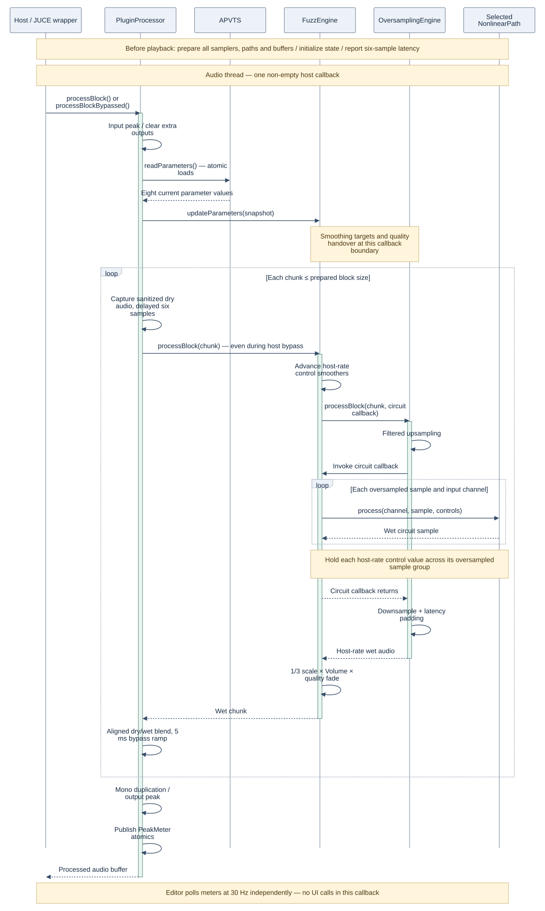

# Pyramid Fuzz architecture diagrams

These views describe the implementation at `c14de77`. Each diagram has an
editable Mermaid source and a rendered SVG. The SVGs display without Mermaid
support or network access; open them directly to zoom without losing detail.

## 1. Component architecture

This is a component overview expressed as a Mermaid flowchart. The processor
instance owns parameter state, the DSP engine, meters and host-bypass buffers.
The editor is created through JUCE and communicates through attachments and
meter snapshots. Solid arrows show runtime calls or processing responsibilities;
dashed arrows show parameter, UI or verification dependencies. The editor's
dashed arrows point to the state and meter providers it accesses; they do not
represent audio or a unidirectional parameter-value stream.



[Editable source](components.mmd) · [Open SVG](components.svg)

`PluginProcessor` and `PluginEditor` are short display names for
`PyramidFuzzAudioProcessor` and `PyramidFuzzAudioProcessorEditor`. APVTS means
`AudioProcessorValueTreeState`. All three samplers and circuit paths are prepared;
only the selected sampler/path pair processes audio. Offline tools are separate
executables, not components loaded into the AU.

## 2. DSP signal flow

Arrows carry audio. Controls appear in the blocks they affect: Input/Voicing,
Sustain, diode mode, Tone/High and Volume. The shaded region runs at the selected
oversampled rate. The dry branch and post-downsampling stages run at host rate.



[Editable source](signal-flow.mmd) · [Open SVG](signal-flow.svg)

- The loaded Sustain/Q3 block solves the base port and updates coupling state;
  it is not an independent gain knob followed by a memoryless waveshaper.
- The Q2 block includes interstage coupling and nonlinear feedback. Diode Off
  opens only its diode branch: Q2's amplifier and Q3's silicon clipping remain.
- Tone and High control the same passive network; High is not a separate EQ.
- Recovery saturation is inside oversampling. The final scale and Volume are
  linear. Natural silicon/germanium level differences are preserved.
- The processor captures dry audio before wet processing overwrites the buffer.
  Host bypass blends delayed dry and wet audio; the wet engine remains active.
- Mono input runs one circuit path per sample, then duplicates to stereo if
  requested. Stereo input keeps two independent channel states.

## 3. Audio-callback sequence

The preparation note describes work completed before playback. The sequence
then follows one non-empty callback, including bounded chunks and the nested
oversampled sample loop. The `NonlinearPath` lifeline is the selected member of
the three-path pool; each member maintains state for its input channels.



[Editable source](audio-callback.mmd) · [Open SVG](audio-callback.svg)

Parameter values are read once per host callback through individual atomic
loads, not as a transaction across all eight parameters. Engine smoothers then
advance at host rate; each value is held across its oversampled sample group.
Quality requests are handled by `updateParameters` at host-callback boundaries:
fade down, select/reset a prepared path when the fade has completed, then fade
up. The sequence shows normal processing, not every quality-transition branch.

Input/output peaks are published after the complete host buffer is processed.
The editor's 30 Hz timer reads atomic meter snapshots independently; it is not
called by the audio thread. Empty callbacks return immediately. Supported buses
are mono/mono, mono/stereo and stereo/stereo; stereo/mono is rejected.

## Source mapping

| View | Main implementation sources |
| --- | --- |
| Components | [Processor](../../src/PluginProcessor.h), [editor](../../src/PluginEditor.h), [engine](../../src/dsp/FuzzEngine.h), [meters](../../src/dsp/PeakMeter.h) |
| Signal flow | [Circuit path](../../src/dsp/NonlinearPath.h), [clippers](../../src/dsp/ClippingStage.h), [tone](../../src/dsp/ToneStack.h), [oversampling](../../src/dsp/OversamplingEngine.h) |
| Callback sequence | [Processor implementation](../../src/PluginProcessor.cpp), [engine implementation](../../src/dsp/FuzzEngine.cpp), [oversampling callback](../../src/dsp/OversamplingEngine.h) |

See [architecture and modeling assumptions](../architecture.md) for the circuit
approximations, voltage scaling and known quality limits.

## Regenerating the images

The committed SVGs were rendered with
[Mermaid CLI](https://github.com/mermaid-js/mermaid-cli) **12.2.0** and the shared
[style configuration](mermaid-config.json). Rendering is separate from CMake and
does not change the plugin, its sound or installed products.

From the project root, install the optional renderer into the ignored build
directory and use an existing Chrome executable:

```bash
PUPPETEER_SKIP_DOWNLOAD=true npm install --prefix build/diagram-tools --no-audit --no-fund @mermaid-js/mermaid-cli@12.2.0
python3 tools/render_diagrams.py \
  --mmdc build/diagram-tools/node_modules/.bin/mmdc \
  --browser "/Applications/Google Chrome.app/Contents/MacOS/Google Chrome" \
  --png-dir artifacts/architecture-diagrams
```

`--browser` is optional if Puppeteer already has a browser installed. An explicit
browser uses a temporary profile, leaving existing browser sessions untouched.
`--png-dir` is optional; PNGs are previews, while SVGs are the committed exports.
When a source changes, regenerate its images and visually inspect the result.
